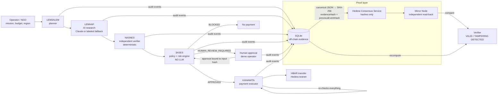

# EL JOKER 2.0 — Architecture

> AI proposes. NASNES verifies. 3ASES decides. Humans control high-risk actions. KANAWITA pays only when authorized. Hedera proves what happened.

## System overview



## Packages

| Path | What |
|---|---|
| `packages/shared` | Zod domain models + API contracts shared by API and UI (Mission, Supplier, Offer, AgentRun, Recommendation, VerificationResult, GuardianDecision, Approval, AuditEvent, Payment, TrailVerification…) |
| `apps/api` | Express 5 + TypeScript API, SQLite (`node:sqlite`), agents, Hedera SDK, Anthropic SDK |
| `apps/web` | Next.js 16 (App Router) + Tailwind v4 mission room. Proxies `/api/*` to the API; holds no secrets |

## API modules (`apps/api/src`)

| Module | Responsibility |
|---|---|
| `agents/lem3alem.ts` | Request → validated `MissionDraft`. Structured input is accepted deterministically; free text is extracted by Claude (structured output) or a rule-based fallback. Missing location/beneficiaries/budget/items ⇒ `NEEDS_INFORMATION`. |
| `agents/marketplace.ts` | **Demo data** research tool: turns fictional supplier price lists into quotes (with hashed quote/license/invoice evidence). |
| `agents/lemhaf.ts` | Ranks offers. `REAL_AI` via Claude (`messages.parse` + Zod schema, low effort, timeout + 1 retry); falls back to an explainable rule-based ranking labeled `FALLBACK` with the reason. Registry status is intentionally not given to the AI. |
| `agents/nasnes.ts` | Deterministic verification: registry, verified status, region, items, arithmetic, evidence, duplicate invoice, unsupported AI claims, suspicious pricing, deadline. |
| `agents/guardian/` | **3ASES**: `policy.json` (versioned) + env overrides → `loadPolicy()` (effective version = `version+hash`), `evaluate(input, policy, approval)` pure function. |
| `agents/kanawita.ts` | Payment executor that re-derives authorization from fresh DB state; see "Payment safety". |
| `agents/context.ts` | Builds the Guardian input snapshot from the DB; idempotency key derivation. |
| `audit/proofService.ts` | `recordEvent()` / `getProof()` / `verifyProof()` / `verifyMissionTrail()` + per-mission ordered HCS anchoring queue + demo-only `tamper()`. |
| `hedera/sdkGateway.ts` | `@hashgraph/sdk` — `Client.forTestnet()` only. `TopicMessageSubmitTransaction`, `TransferTransaction`, receipt handling. |
| `hedera/mirror.ts` | Mirror Node REST client (`/api/v1/topics/{id}/messages/{seq}`, `/api/v1/transactions/{id}`, `/api/v1/accounts/{id}`). |
| `hedera/simulatedGateway.ts` | Used only without credentials. Labeled SIMULATED everywhere; never produces transaction ids or HashScan links. |
| `orchestrator/missionService.ts` | Pipeline, human approval, replay attack, verification, feed messages. |
| `db/store.ts` | SQLite schema + repositories. Unique constraints enforce payment idempotency. |

## Data model (SQLite)

| Table | Key columns | Notes |
|---|---|---|
| `missions` | `mission_id` PK, `status`, `scenario_id` | full Mission JSON |
| `suppliers` | `supplier_id` PK | demo registry (fictional) |
| `offers` | `offer_id` PK, `mission_id`, `invoice_id` | |
| `recommendations` | `mission_id` PK | LEMHAF output |
| `agent_runs` | `run_id` PK | mode, model, input hash, summary, fallback reason — never chain-of-thought |
| `verifications` | `verification_id` PK | NASNES result |
| `guardian_decisions` | `decision_id` PK | decision, checks, risk, policy version, input hash |
| `approvals` | `approval_id` PK, **UNIQUE(mission_id)** | bound to `guardianInputHash` + policy version |
| `payments` | **UNIQUE(idempotency_key)**, partial UNIQUE(mission_id) and UNIQUE(invoice_id) where status ≠ FAILED | duplicate payment is impossible at the DB layer |
| `audit_events` | UNIQUE(mission_id, sequence), `payload_json`, `evidence_hash`, `previous_event_hash`, `event_hash`, `anchor` | hash-linked chain |
| `feed` | | group-chat messages |
| `trail_verifications` | | last verification report |
| `simulated_ledger` | | only used without Hedera credentials |

## Audit chain & Hedera proof

For each event:

```
payloadJson      = canonicalize(payload)            // sorted keys, no whitespace
evidenceHash     = SHA-256(payloadJson)
eventHash        = SHA-256(canonicalize({schemaVersion, eventId, missionId, sequence,
                                         eventType, agent, policyVersion, timestamp,
                                         evidenceHash, previousEventHash}))
previousEventHash = eventHash of the previous event (genesis = 64 zeros)
```

HCS message (one chunk, < 1 KB, no personal data, no prices, no documents):

```json
{"e":"evt_…","eh":"<eventHash>","h":"<evidenceHash>","m":"msn_…","p":"eljoker","ph":"<previousEventHash>","pv":"2.0.0+…","s":3,"t":"GUARDIAN_APPROVED","ts":"…","v":"1"}
```

Verification (`verifyMissionTrail`):
1. **List** every message on the topic since the mission was created (Mirror Node `/api/v1/topics/{id}/messages`, paginated) and keep the ones whose `m` is this mission, keyed by `eventId`. The listing is retried while the Mirror Node is still indexing.
2. For every local event: recompute `evidenceHash` from the payload **as currently stored** in SQLite, recompute `eventHash`, check the `previousEventHash` link, and compare `h`, `eh`, `ph`, `e` with the ledger message found **by eventId** (falls back to the stored sequence number). The local anchor metadata must point at that same message; missing metadata is backfilled from the ledger (erasing it hides nothing).
3. **Completeness**: any proof on the ledger whose local event no longer exists is reported as deleted history.

Result per event: `VALID` · `TAMPERED` · `PENDING` (not yet indexed / Mirror unreachable) · `MISSING_PROOF`. Overall: `VALID` · `TAMPERING_DETECTED` (any tampered **or deleted** event) · `PENDING` · `UNVERIFIABLE`. A detected tamper is itself recorded as `TAMPER_DETECTED` on HCS (once per distinct set of affected events).

**Why not just a database?** The demo includes three tamper modes:
- *Edit evidence* — local hash check already fails.
- *Insider rewrites hashes too* — payload changed **and** the whole local chain recomputed. Every local check passes; only the comparison with the Hedera consensus record fails.
- *Delete last event* — e.g. the payment record or a blocked attempt is erased. The remaining chain is perfectly consistent; only the ledger listing shows a proof with no local event.

The last two are the attacks a normal database (even with its own hash chain) cannot detect.

## Payment safety (KANAWITA)

Before any transfer KANAWITA, independently of its caller:
1. rebuilds the Guardian input from fresh DB state and re-runs 3ASES → must be `APPROVED`;
2. requires NASNES `VERIFIED` for the same offer;
3. requires a valid human approval (authorized actor, bound to the same input hash + policy version) whenever the policy demanded review;
4. requires the mission to be unpaid and the idempotency key unused;
5. (live mode) waits for the `GUARDIAN_APPROVED` proof to be **anchored on Hedera** — no proof, no payment;
6. computes the scaled demo settlement **from the authorized amount** (`offer USD / 1000 × DEMO_SETTLEMENT_HBAR_PER_1000_USD`, capped at `DEMO_SETTLEMENT_MAX_HBAR`; $4,150 → 1.0375 ℏ), inserts the payment row (DB unique constraints) → `PAYMENT_INITIATED` proof → single-shot `TransferTransaction` (never re-signed on failure; receipt re-queried by the same transaction id) → receipt `SUCCESS` → `PAID` + `PAYMENT_CONFIRMED` proof → async Mirror Node confirmation. Any failure → `PAYMENT_FAILED` proof; never marked paid.

An in-process per-mission lock plus the DB constraints make concurrent double execution produce at most one payment (tested).

## Human approvals

High-risk decisions stop in `HUMAN_REVIEW`. An approval needs an authorized operator (`DEMO_OPERATORS`) **and** the operator PIN (`DEMO_OPERATOR_PIN`; documented demo default `0619` only when `DEMO_MODE=true`), compared in constant time with a 60 s lockout after 5 failures. The approval is stored once per mission and bound to the Guardian input hash + policy version it was given for; 3ASES re-runs with it, and an unauthorized, stale or rejected approval can never turn a review into a payment. This is a demo operator mode, not a production identity system.

## 3ASES policy (v2.0.0)

| Check | Outcome on failure |
|---|---|
| Valid mission state (EVALUATING / HUMAN_REVIEW / APPROVED) | BLOCK |
| NASNES verification = VERIFIED for this offer | BLOCK |
| Verified supplier (in registry + verified) | BLOCK |
| Allowed region (policy list) and supplier serves it | BLOCK |
| Allowed spending category (WATER, MEDICINE, FOOD, HYGIENE, SHELTER) | BLOCK |
| Currency match (USD) | BLOCK |
| Within mission budget | BLOCK |
| Price anomaly vs reference: > +60% | BLOCK; > +25% or < −40% → REVIEW |
| Duplicate invoice / missing invoice | BLOCK |
| Duplicate payment / idempotency key used | BLOCK |
| Transaction > max ($25,000) | BLOCK |
| Transaction > autonomous limit ($5,000) | REVIEW |
| Risk level ≥ human threshold (HIGH) | REVIEW |

Risk score: +40 above autonomous limit, +20 price anomaly, +15 per supplier risk flag, +10 offer ≥ 90% of budget, +10 critical urgency. Bands: <20 LOW, <40 MEDIUM, <70 HIGH, else CRITICAL; any BLOCK ⇒ CRITICAL.
Decision: any BLOCK ⇒ `BLOCKED`; else any REVIEW ⇒ `HUMAN_REVIEW_REQUIRED` (or `APPROVED` with a valid bound approval, `BLOCKED` if the operator rejected); else `APPROVED`.

## Why no smart contract

HCS (ordered, timestamped, tamper-evident proofs) + a native HBAR `TransferTransaction` + Mirror Node verification already cover proof and settlement for this MVP. The authorization logic must remain readable, deterministic, versioned off-chain code that judges and auditors can inspect and unit-test; moving it into a contract would add deployment risk and gas/fee complexity without solving a stated requirement. A contract (or Hedera Scheduled Transactions for multi-signature release) becomes justified for real escrow or multi-party approval — listed as future work.

## AI boundaries

- The Anthropic API key lives only in the API process (`.env`); the browser never sees it.
- Claude is used for LEM3ALEM free-text extraction and LEMHAF ranking. It never sees or sets authorization fields.
- Output is schema-validated (`zodOutputFormat` + domain Zod schema); non-existent offer ids or schema violations ⇒ `FALLBACK`.
- Stored metadata only: provider, model, mode, timestamp, input hash, short summary, fallback reason. No chain-of-thought is requested or stored.
